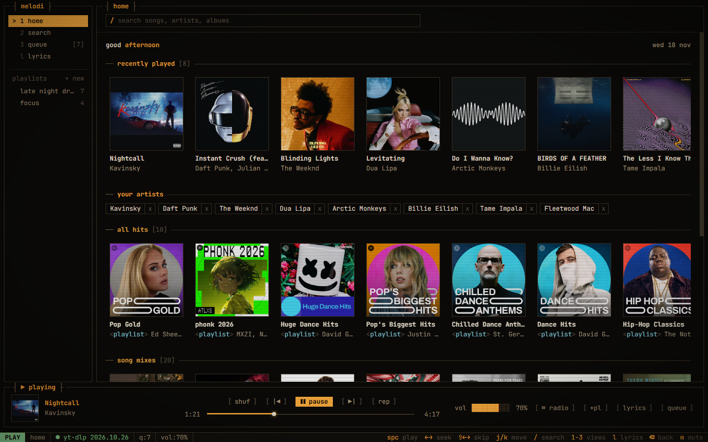
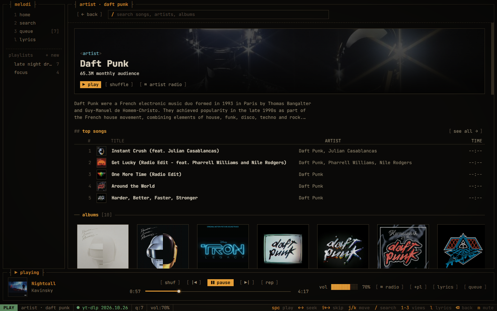
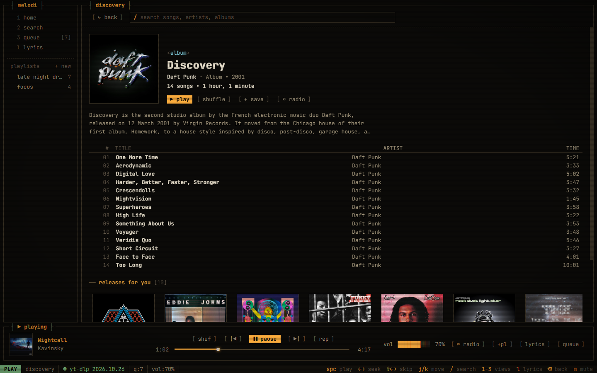
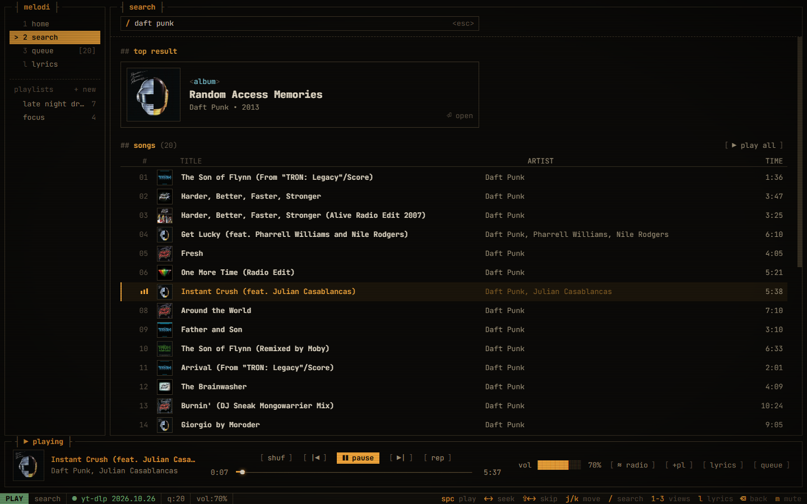
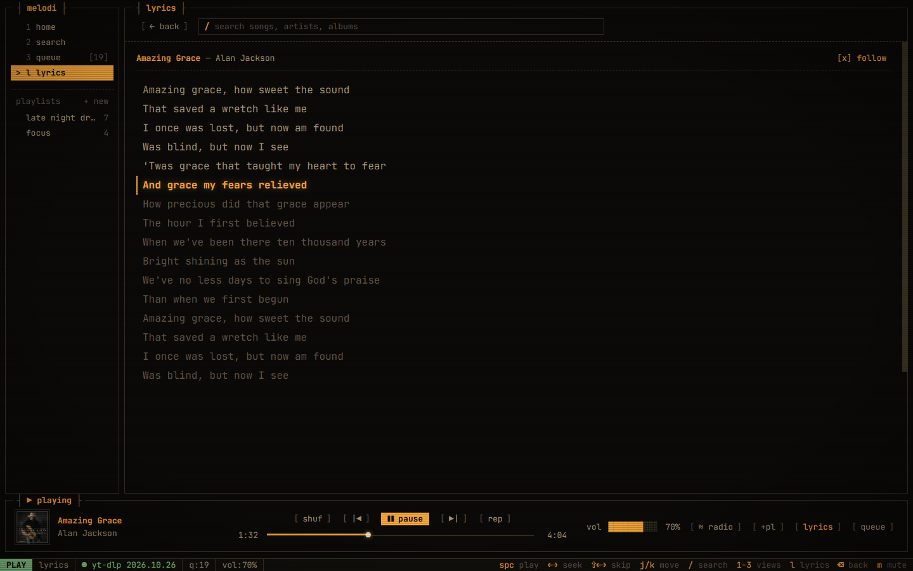
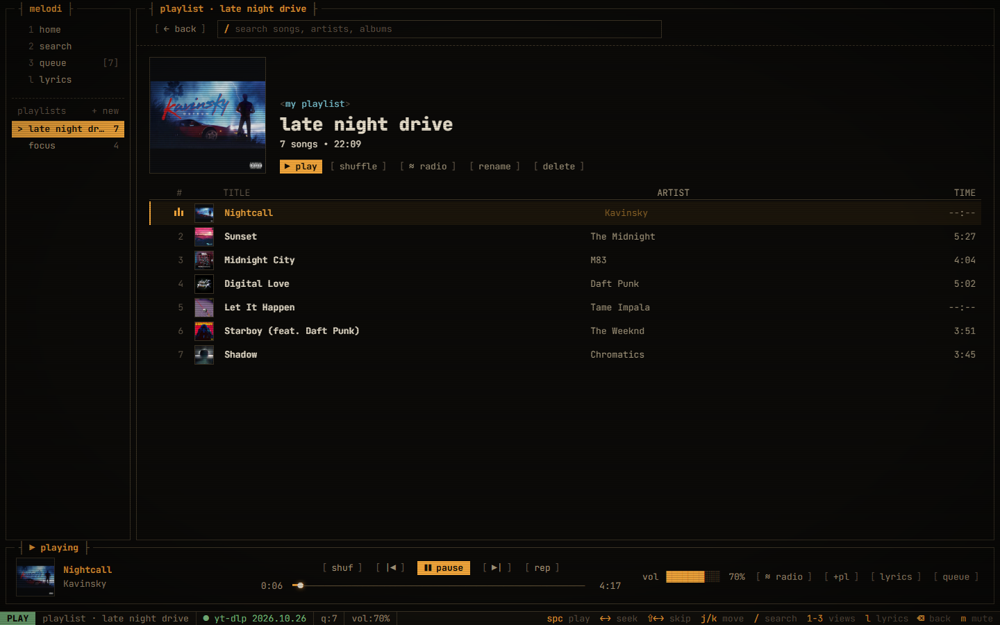
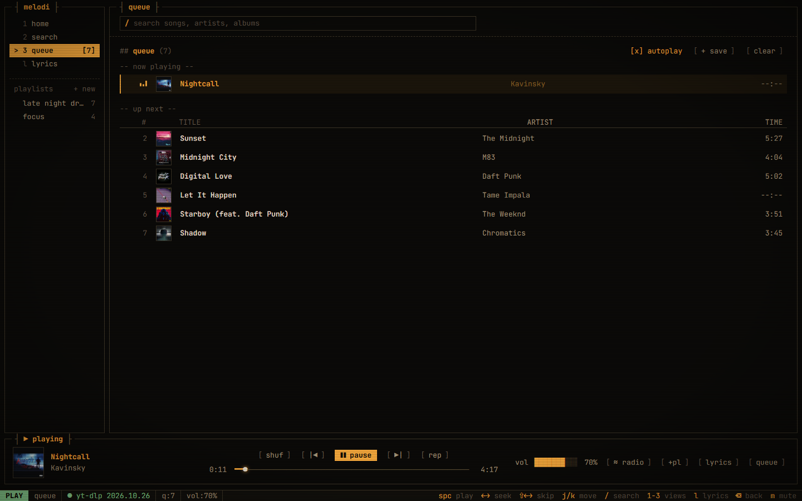

# Melodi 🎧

[](https://ko-fi.com/nix100)

A cross-platform, **ad-free desktop music client** built with **Rust + Tauri 2**.
It streams YouTube Music's catalog through YouTube's public backend — **no account,
no sign-up, no ads** — with an original UI that is *not* a YouTube Music clone.

> **Status:** functional MVP. Search + browse + streaming playback work today.



## Download

**[⬇ Get the latest release](https://github.com/nixxane/melodi/releases/latest)** · 🌐 **[getmelodi.xyz](https://getmelodi.xyz)**

| Platform | File | How |
| --- | --- | --- |
| **Windows 10/11** | `Melodi_x.y.z_x64-setup.exe` | Run it. No admin rights needed. |
| **Linux** | `Melodi_x.y.z_amd64.AppImage` | `chmod +x Melodi_*.AppImage`, then run it. |
| **Debian / Ubuntu** | `Melodi_x.y.z_amd64.deb` | `sudo apt install ./Melodi_*.deb` |

> **"Windows protected your PC"?** The installer isn't code-signed (that costs money),
> so Windows SmartScreen warns about it. Click **More info → Run anyway**. The source
> is all here, and every release is built by GitHub Actions from this repository.

Melodi **updates itself**: when a new version is out, it offers to install it in the app
(the `.deb` version links you to the download page instead). It also keeps its copy of
yt-dlp up to date in the background, since YouTube regularly breaks older versions.

## Screenshots

| Artist | Album |
| --- | --- |
|  |  |
| **Search** | **Synced lyrics** |
|  |  |
| **Your playlists** | **Queue** |
|  |  |

---

## How it works

Melodi uses two complementary backends:

| Concern | Engine | Why |
| --- | --- | --- |
| **Search & browse** (metadata, thumbnails, artists) | Pure-Rust **InnerTube** client (`src-tauri/src/innertube.rs`) | YouTube Music's public WEB_REMIX API — no auth required |
| **Audio stream resolution** | **yt-dlp** (`src-tauri/src/ytdlp.rs`) | YouTube's unauthenticated `player` endpoint now requires a Proof-of-Origin token. yt-dlp is the battle-tested extractor that keeps up with these changes (signature + `n` deciphering, throttling). |

The frontend is a **React + TypeScript + Vite** app. The Rust backend exposes six
commands — `search`, `browse_home`, `up_next`, `resolve_stream`, `prefetch_stream`,
`backend_status` — via Tauri IPC.

```
┌──────────────────────────────────────────────────────────┐
│  React UI (custom design)                                │
│  sidebar · home shelves · search · queue · player bar    │
└──────────────┬───────────────────────────────────────────┘
               │ Tauri IPC (invoke)
┌──────────────▼───────────────────────────────────────────┐
│  Rust backend                                            │
│  • innertube.rs  → InnerTube WEB_REMIX (search/browse)   │
│  • ytdlp.rs      → yt-dlp (resolve progressive audio URL)│
└──────────────┬───────────────────────────────────────────┘
               │ HTTPS
      ┌────────▼────────┐        ┌─────────────────────┐
      │ music.youtube.com │        │ googlevideo.com      │
      │ (InnerTube API)  │        │ (audio stream)       │
      └─────────────────┘        └─────────────────────┘
```

The resolved stream URL is handed back to the webview, which plays it in an
HTML5 `<audio>` element. Because playback never touches YouTube's ad-serving web
player, there are simply no ads to serve — not "ad blocking", just a clean
direct stream.

---

## Features

- 🔎 **Search** songs, artists, albums (no account needed) with a top result, recent searches and skeleton loading
- 👤 **Artist pages** — top songs, albums, singles, videos, "fans might also like", plus shuffle and artist radio
- 💿 **Album & playlist pages** — full track lists (playlists up to ~300 tracks), shuffle, radio
- 🔴 **Live streams** — 24/7 radio and live sets (e.g. lofi streams) play like any other track. Pausing and playing again jumps back to live. The local proxy follows YouTube's HLS playlist and joins the segments into one audio stream.
- 📻 **Radio** — start a radio of similar songs from any track (right-click → start radio, or `≈` in the player)
- 🎤 **Lyrics** (`L`) — time-synced, auto-scrolling lyrics from [LRCLIB](https://lrclib.net) (click a line to jump there), falling back to YouTube Music's plain lyrics. Lookups send only the track title, artist and length.
- 🎮 **Discord Rich Presence** — shows "Listening to <artist>" with the song, cover art, progress bar and a YouTube Music button. Talks only to your local Discord client; toggle with `discord:on/off` in the status bar.
- 🎧 **Sound** — volume normalization (from YouTube's own loudness data), crossfade (2–12 s), and a 7-band equalizer with presets. Audio plays through a small local proxy on `127.0.0.1` so it can be processed; the proxy only answers requests carrying a random per-run key.
- 📴 **Offline cache** — songs you play (and the next one in the queue) are saved to disk, so replays start instantly and work without internet. Size limit is adjustable (or off) in settings; least recently played songs are removed first.
- 🟢 **Import from Spotify** — paste a Spotify playlist, album or song link (into search or `⇣ import playlist`) and Melodi finds each song on YouTube Music by title, artist and length, preferring the original over covers, live or sped-up versions. Links show the first 100 songs; for longer playlists import a CSV export (e.g. from exportify.net). No Spotify account needed.
- 🔗 **Paste a YouTube / YouTube Music link** into search: playlists open (then `+ save` to keep them), song links play with similar songs queued after.
- 💤 **Sleep timer** (`Z`): 15 / 30 / 45 / 60 min or end of the song, with a gentle fade-out; pauses rather than quitting.
- 🪟 **Mini player** and **tray icon**: a small always-on-top strip, tray controls (play/pause, next, previous), and an optional "close to tray".
- ♥ **Liked songs** — like with `F`, the ♡ on any row, or right-click; all your likes in one list.
- 🎨 **Themes** — amber, phosphor (green), ice, catppuccin, gruvbox, mono and paper (light); scanlines and text size are adjustable.
- ⚙️ **Settings** (`,`) — themes, region & language for shelves and search (e.g. Türkiye / Türkçe), autoplay, session restore, Discord, update checks, and clearing your local data.
- 📝 **Your playlists** — create, rename, reorder (drag) and delete; add songs from any row (`+pl`, right-click), the player, or save a whole queue / album. Stored locally.
- 🕘 **Recently played** and "your artists" on Home, kept locally. A song only counts after 30 s of listening (or half a short track), and artists can be hidden with `x`.
- 🏠 **Home shelves** (quick picks, new releases, moods & genres) with a time-aware greeting
- ▶️ **Playback** — shuffle, repeat (off / all / one), smart previous (restarts after 3 s), seek with hover preview, volume with mute
- 🧭 **Queue** — play next / add to queue (buttons and right-click menu), drag to reorder, remove, clear
- 📻 **Autoplay radio** — when the queue runs out, similar songs are appended automatically (toggle in the queue header)
- 💾 **Session restore** — the queue and your position come back after a restart (paused)
- 🎹 **OS media keys** and now-playing card via the Media Session API; the window title follows the track
- 🚀 **Fast starts** — resolved stream URLs are cached, the next track is downloaded ahead of time, and expired streams recover automatically
- 🖥️ **Terminal-style UI** — amber-phosphor TUI look (JetBrains Mono, boxed panels, ASCII seek/volume bars, vim-style status line), with `1`/`2`/`3` view switching and `j`/`k` list navigation
- ⚡ **Self-provisioning** — downloads yt-dlp automatically on first run (checksum-verified) if it's missing

### Keyboard shortcuts

| Key | Action |
| --- | --- |
| `Space` | Play / pause |
| `←` / `→` | Seek −5 s / +5 s |
| `Shift` + `←` / `→` | Previous / next track |
| `↑` / `↓` | Volume +5% / −5% |
| `M` | Mute / unmute |
| `L` | Lyrics |
| `F` | Like / unlike the current song |
| `,` | Settings |
| `Z` | Sleep timer (cycle) |
| `Esc` (mini player) | Back to the full window |
| `Backspace` / `Alt`+`←` / mouse back | Back |
| `/` or `Ctrl`+`K` | Focus search |
| `1` / `2` / `3` | Home / Search / Queue |
| `j` / `k` | Move down / up through rows and cards (`Enter` plays) |
| `Esc` (in search) | Clear and leave the search box |

Shortcuts are ignored while you're typing in a text field.

---

## Getting started

### Prerequisites

- **Rust** (1.77+) with the MSVC toolchain — https://rustup.rs
- **Node.js** 20+ and **pnpm** — `corepack enable` or https://pnpm.io
- On Windows: **WebView2** (preinstalled on Windows 10/11)
- Optional but recommended: **ffmpeg** on your `PATH` (used by yt-dlp for some
  edge cases; most music plays fine without it)

### Run in development

```bash
pnpm install
pnpm tauri dev
```

The backend auto-locates yt-dlp from (in order): `$MELODI_YTDLP`, your `PATH`,
the `src-tauri/binaries/` folder, or downloads it to your app-data directory.

### Build a release

```bash
pnpm tauri build
```

### Publish a release (maintainers)

1. Bump the version in `package.json`, `src-tauri/Cargo.toml` and `src-tauri/tauri.conf.json`.
2. Commit, then tag and push: `git tag v0.2.1 && git push origin v0.2.1`.
3. GitHub Actions (`.github/workflows/release.yml`) builds the Windows and Linux
   installers, signs the update bundles, and publishes the Release with `latest.json`,
   which installed copies check for updates.

Update bundles are signed with the key in the `TAURI_SIGNING_PRIVATE_KEY` /
`TAURI_SIGNING_PRIVATE_KEY_PASSWORD` repository secrets; the public key is in
`tauri.conf.json`. Losing the private key means existing installs can no longer update.

---

## Configuration

| Setting | How |
| --- | --- |
| Custom yt-dlp path | set the `MELODI_YTDLP` environment variable |
| Client locale / region | `hl` / `gl` fields in `src-tauri/src/innertube.rs` |
| Stream format | `resolve_stream` in `src-tauri/src/ytdlp.rs` (defaults to best progressive audio) |

---

## Known limitations (honest notes)

- **Live streams** play at the live edge only: you can't rewind into the broadcast,
  and they aren't saved to the offline cache. Streams that have no audio-only
  format (rare) won't play.
- **Podcasts / episodes / user profiles** aren't supported and are left out of search.
- YouTube periodically tightens its anti-bot measures. Melodi updates its own copy of
  yt-dlp every couple of days, and right away when a track fails to load. If you
  point it at your own yt-dlp (`MELODI_YTDLP` or `PATH`), keep that one updated yourself.
- yt-dlp resolves URLs in your region; streams are IP-locked and expire after a
  few hours — a URL is only valid for immediate playback, which is fine for a player.

---

## Support

Melodi is free and has no ads, accounts or tracking. If you enjoy it, you can
support development on **[Ko-fi](https://ko-fi.com/nix100)** ☕

## License

Melodi is free software: you can redistribute it and/or modify it under the
terms of the **GNU General Public License v3.0 or later** — see [LICENSE](LICENSE).
Anything built on Melodi and distributed must stay open source under the same terms.

## Legal

Melodi is an **independent, unofficial client**. It is not affiliated with,
endorsed by, or connected to YouTube or Google. "YouTube Music" is a trademark of
its respective owner; the name is used only to describe the service this tool
interfaces with. This project provides no copyrighted content and no tools to
download or retain it. Use is at your own risk and subject to the terms of any
service you connect to.

---

## Project layout

```
melodi/
├── src/                    # React frontend (custom UI)
│   ├── App.tsx
│   ├── components/         # Sidebar, PlayerBar, TrackList, HomeView, SearchView, Card, ShelfRow, ContextMenu, Toasts
│   ├── lib/                # usePlayer, useQueue, useSearch, useToasts, shortcuts, media session, format helpers
│   └── api.ts              # typed Tauri invoke wrappers
├── src-tauri/              # Rust backend
│   ├── src/
│   │   ├── lib.rs          # app bootstrap + command registration
│   │   ├── innertube.rs    # InnerTube (WEB_REMIX) client + parsers
│   │   ├── ytdlp.rs        # yt-dlp stream resolver
│   │   └── commands.rs     # Tauri IPC commands
│   ├── binaries/           # bundled yt-dlp (dev convenience)
│   ├── capabilities/       # Tauri capability (default)
│   └── tauri.conf.json
└── scripts/gen_icon.py     # app-icon generator (Pillow)
```
